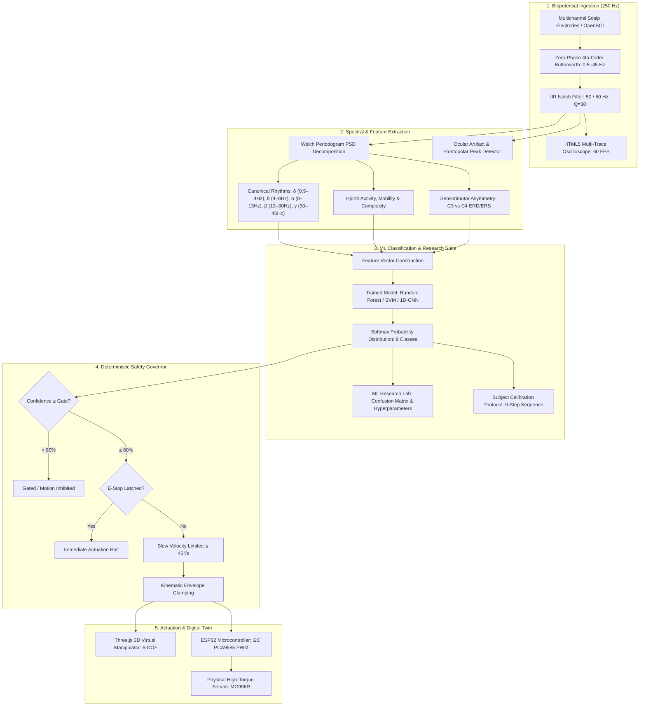

# NEUROARM
### EEG-Powered Intelligent Robotic Arm Control & BCI Research Platform

[](https://github.com/)
[](https://github.com/)
[](https://fastapi.tiangolo.com)
[](https://react.dev)
[](https://threejs.org)
[](https://www.espressif.com)
[](LICENSE)

---

## 🔬 Executive Overview

**NEUROARM** is a research-grade, full-stack Brain-Computer Interface (BCI) and robotic manipulation platform. Engineered for neuroscientists, biomechatronic engineers, and robotics researchers, NEUROARM bridges electrophysiological biopotential ingestion with deterministic multi-joint inverse kinematics and real-time machine-learning inference.

The platform couples high-frequency biopotential signal processing ($250\text{ Hz}$, 8-channel 10–20 standard montage) with an industrial-grade 6-DOF robotic manipulator simulation, an automated motor-imagery subject calibration pipeline, and a deterministic safety-gate governor.

> [!IMPORTANT]
> **Scientific Integrity & Scope**: NEUROARM pattern-matches sensorimotor rhythm shifts (Event-Related Desynchronization/Synchronization, ERD/ERS) and ocular electro-oculographic deflections across motor cortex channels ($C3, C4$). It does **not** claim to read subjective thoughts, semantic internal monologue, or conscious intent.

---

## 🏛️ System Architecture



---

## 🌟 Core Platform Capabilities

### 1. High-Precision Biopotential Ingestion
- **Standard 10–20 Montage**: 8-channel acquisition across frontopolar, sensorimotor, parietal, and occipital sites (`Fp1`, `Fp2`, `C3`, `C4`, `P3`, `P4`, `O1`, `O2`).
- **Digital Filtering Pipeline**:
  - 4th-order zero-phase digital Butterworth bandpass filter ($0.5 - 45\text{ Hz}$) eliminating drift and myogenic interference.
  - 2nd-order IIR Notch filter ($Q = 30$) eliminating $50\text{ Hz}$ or $60\text{ Hz}$ AC powerline hum.
- **Microvolt Baseline Trace**: 60 FPS HTML5 canvas renderer with channel-specific DC offset subtraction and active impedance validation.

### 2. Quantitative Neuroscience & SMR Analytics
- **Welch Power Spectral Density (PSD)**: Segmented Hanning-windowed spectral estimation ($N = 256$, 50% overlap).
- **Canonical Rhythms**: Continuous band power tracking for **Delta** ($0.5–4\text{ Hz}$), **Theta** ($4–8\text{ Hz}$), **Alpha** ($8–13\text{ Hz}$), **Beta** ($13–30\text{ Hz}$), and **Gamma** ($30–45\text{ Hz}$).
- **Electrophysiological Indices**:
  - Theta/Beta Ratio (TBR) and Alpha/Beta Ratio (ABR) vigilance metrics.
  - Hjorth Parameters: **Activity** (variance $\sigma_x^2$), **Mobility** (mean frequency estimate), and **Complexity** (spectral purity).
  - Contralateral sensorimotor rhythm (SMR) differential index between $C3$ (dominant during right-hand imagery) and $C4$ (dominant during left-hand imagery).

### 3. Machine Learning & Research Suite
- **8-Class Motor-Imagery Vocabulary**:
  $$\{\text{REST}, \text{LEFT}, \text{RIGHT}, \text{FORWARD}, \text{BACKWARD}, \text{GRIP}, \text{RELEASE}, \text{STOP}\}$$
- **4-Tab ML Research Workstation (`/ml`)**:
  - **Evaluation & Confusion Matrix**: 8×8 normalized confusion matrix with an accessible monochromatic clinical gradient, class sample balances, and precision/recall/macro-F1 metrics.
  - **Architecture & Hyperparameter Tuning**: Parameter exploration (estimators, max depth, learning rate) and real-time loss/validation curves.
  - **Dataset & Feature Space**: Horizontal Gini feature importance displays ($C3/C4$ bandpower, spectral entropy, Hjorth complexity).
  - **Model Registry & Benchmark**: Version-controlled model weights, inference latency metrics ($\approx 12.4\text{ ms}$), and active model dispatching.
- **9-Step Subject Calibration Protocol (`/calibration`)**:
  $$\text{1 Prepare} \longrightarrow \text{2 REST} \longrightarrow \text{3 LEFT} \longrightarrow \text{4 RIGHT} \longrightarrow \text{5 GRIP} \longrightarrow \text{6 RELEASE} \longrightarrow \text{7 STOP} \longrightarrow \text{8 Review} \longrightarrow \text{9 Train}$$
  Includes phase countdown timers, real-time sample counters (`@ 250 Hz FS`), signal fidelity tracking, and automated model re-fitting.
- **Clinical Session Archive (`/sessions`)**: Indexed database of recording sessions with sample metrics, artifact rejection ratios, and triggers for **EDF** (European Data Format) and **CSV** raw data export.

### 4. 6-DOF Industrial Digital Twin
- **Three.js & React Three Fiber Viewport**: Industrial neutral metallic finish in a clinical daylight studio environment with millimeter-accurate floor grid.
- **Kinematic Hierarchy**:
  | Joint | Function | Range | Motion Type |
  | :--- | :--- | :--- | :--- |
  | **J1** | Base Turntable | $-170^\circ \text{ to } +170^\circ$ | Yaw Rotation |
  | **J2** | Shoulder Articulation | $-60^\circ \text{ to } +120^\circ$ | Pitch Elevation |
  | **J3** | Elbow Articulation | $-150^\circ \text{ to } +150^\circ$ | Pitch Flexion |
  | **J4** | Wrist Elevation | $-90^\circ \text{ to } +90^\circ$ | Pitch Adjustment |
  | **J5** | Wrist Orientation | $-180^\circ \text{ to } +180^\circ$ | Axial Roll |
  | **J6** | Parallel End-Effector | $0\% \text{ to } 100\%$ | Linear Clamp |
- **Real-Time Forward Kinematics**: Continuous Tool Center Point (TCP) Cartesian coordinates calculation $(X, Y, Z\text{ in mm})$.

### 5. Multi-Tier Deterministic Safety Architecture
1. **Confidence Floor Gating**: Discards any prediction with confidence below the configured threshold ($\text{default } \ge 80\%$) to prevent spurious actuation.
2. **Emergency Stop (E-Stop) Priority**: Hardware and software latching mechanism that immediately halts all PWM output and locks the kinematic chain.
3. **Kinematic Clamping**: Hard geometric limit enforcement on all joint servomotors.
4. **Velocity Slew Limiting**: Caps angular acceleration ($\le 45^\circ/\text{sec}$) to prevent mechanical backlash and motor driver overcurrent.
5. **Heartbeat Watchdog**: Background watchdog that initiates controlled kinematic homing if WebSocket packets are dropped for $>500\text{ ms}$.

---

## 🎨 Design System & Visual Philosophy

The user interface follows a **White / Light Scientific & Medical Workstation Theme**, prioritizing information density, clean typography, and zero visual distractions:

- **Color Tokens**:
  - Canvas & Viewport: `#F8FAFC`
  - Workstation Surfaces: `#FFFFFF`
  - Secondary Surfaces: `#F1F5F9`
  - Structural Borders: `#E2E8F0` / `#CBD5E1`
  - Clinical Accent: `#2563EB` (Light: `#EFF6FF`)
  - Status Indicators: `#16A34A` (Nominal), `#D97706` (Gated), `#DC2626` (Emergency)
- **Zero Distractions**: Strictly eliminates neon glow effects, cyber gradients, dark panels, and decorative AI graphics in favor of readable charts and tabular data.

---

## 📁 Repository Structure

```
neuroarm/
├── backend/                      # Python FastAPI Computational Backend
│   ├── app/
│   │   ├── api/                  # REST routers & WebSocket endpoints (/ws/eeg)
│   │   ├── core/                 # Config, security, embedded database
│   │   ├── eeg/                  # Signal generators, Butterworth/Notch filters, Welch PSD
│   │   ├── ml/                   # Feature extraction, model trainer, inference engine
│   │   ├── robotics/             # Forward kinematics, trajectory planner, command mapper
│   │   ├── safety/               # Deterministic safety gate, E-stop latch, slew limiter
│   │   └── hardware/             # Serial UART & ESP32 communication bridge
│   ├── tests/                    # Comprehensive Pytest verification suite
│   ├── requirements.txt          # Python dependencies
│   └── run.py                    # Server entrypoint
│
├── frontend/                     # Modern React + TypeScript Workstation UI
│   ├── src/
│   │   ├── components/           # Scientific components (WaveformCanvas, Charts, Tables)
│   │   ├── context/              # EEGContext, DemoContext, RobotContext
│   │   ├── layouts/              # AppLayout, Scientific Sidebar, Clinical TopBar
│   │   ├── pages/                # All 13 application views (Dashboard, ML, Calibration, etc.)
│   │   ├── three/                # Three.js 6-DOF RoboticArmMesh, ArmCanvas
│   │   └── types/                # Strict TypeScript domain interfaces
│   ├── package.json
│   └── vite.config.ts
│
├── esp32/                        # Embedded C++ Firmware for Microcontroller
│   ├── src/main.cpp              # PCA9685 I2C driver, JSON command parser, Watchdog
│   ├── platformio.ini            # PlatformIO build configuration
│   └── README.md                 # Firmware flashing instructions
│
├── docs/                         # Specifications & Engineering Schematics
│   ├── ARCHITECTURE.md           # Mathematical formulations and filter designs
│   └── WIRING_ESP32.md           # Complete electrical schematic and pinout diagrams
│
├── docker-compose.yml            # Containerized deployment manifest
└── README.md                     # Platform documentation
```

---

## 🚀 Getting Started

### Prerequisites
- **Python**: 3.11 or higher
- **Node.js**: 18.x or higher (`npm` 9+)
- *(Optional for physical hardware)*: ESP32 development board, Adafruit PCA9685 PWM driver, 6V 10A DC power supply, 6x MG996R servos.

### 1. Backend Setup

```bash
# Navigate to backend directory
cd backend

# Create and activate a virtual environment
python -m venv venv
# On Windows:
.\venv\Scripts\activate
# On Linux/macOS:
source venv/bin/activate

# Install dependencies
pip install -r requirements.txt

# Launch the FastAPI server
python run.py
```
> The API server will be available at `http://localhost:8000`.  
> Interactive OpenAPI documentation: `http://localhost:8000/docs`.

### 2. Frontend Setup

```bash
# Navigate to frontend directory
cd frontend

# Install dependencies
npm install

# Start the Vite development server
npm run dev
```
> The web application will launch at `http://localhost:5173`.

---

## 📡 API & WebSocket Specification

### WebSocket Channels
- **`ws://localhost:8000/ws/eeg`**: Full duplex high-frequency biopotential stream ($250\text{ Hz}$). Broadcasts raw/filtered microvolt packets, Welch PSD arrays, band power distributions, model predictions, and safety states.

### REST Endpoints
| Method | Endpoint | Description |
| :--- | :--- | :--- |
| `GET` | `/api/health` | Subsystem telemetry, active connections, and uptime status |
| `GET` | `/api/eeg/latest` | Latest 250-sample filtered buffer and spectral decomposition |
| `POST` | `/api/models/train` | Triggers background model training on calibrated dataset |
| `GET` | `/api/models/active` | Retrieves metadata, accuracy, and hyperparameters of active classifier |
| `POST` | `/api/robot/command` | Dispatches manual or synthetic intent command to safety governor |
| `POST` | `/api/robot/estop` | Latches or releases emergency stop state |
| `GET` | `/api/sessions` | Lists recorded BCI sessions with download triggers |

---

## 🧪 Automated Testing & Validation

### Backend Pytest Suite
Run the automated test suite verifying digital filters, spectral calculators, ML classification, and safety barriers:
```bash
cd backend
python -m pytest tests/ -v
```

### Frontend Build Verification
Verify strict TypeScript compilation and production bundle generation:
```bash
cd frontend
npm run build
```

---

## 🔌 Physical Hardware Assembly (ESP32 + PCA9685)

For researchers operating a physical 6-DOF manipulator:

1. Flash the firmware using PlatformIO:
   ```bash
   cd esp32
   pio run -t upload
   ```
2. Connect ESP32 to the PCA9685 16-channel servo controller over I2C:
   - **GPIO 21**: `SDA`
   - **GPIO 22**: `SCL`
   - **GND**: Shared common ground
3. Provide an isolated **5V–6V 10A DC power supply** directly to the PCA9685 V+ terminal.
4. See [WIRING_ESP32.md](docs/WIRING_ESP32.md) for full electrical decoupling and schematic instructions.

---

## 📑 Scientific References & Citations

If you utilize NEUROARM in your research, please reference the following foundations:
- **Pfurtscheller, G., & da Silva, F. H. L.** (1999). *Event-related EEG/MEG synchronization and desynchronization: basic principles*. Clinical Neurophysiology, 110(11), 1842-1857.
- **Hjorth, B.** (1970). *EEG analysis based on time domain properties*. Electroencephalography and Clinical Neurophysiology, 29(3), 306-310.
- **Welch, P.** (1967). *The use of fast Fourier transform for the estimation of power spectra: A method based on time averaging over short, modified periodograms*. IEEE Transactions on Audio and Electroacoustics, 15(2), 70-73.

---

## 🛡️ License

This project is licensed under the **MIT License** — see the [LICENSE](LICENSE) file for details. Built for scientific reproducibility, neurotechnology research, and open-source biomechatronics.
