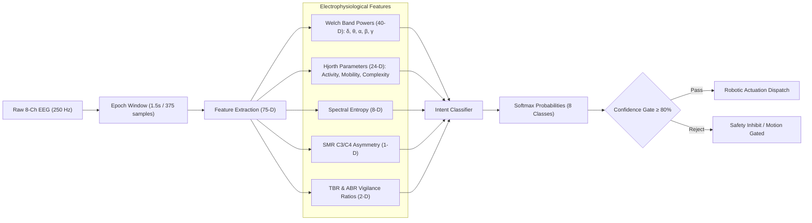

# NEUROARM Machine Learning & BCI Inference Engine

This package implements the end-to-end Machine Learning pipeline for the **NEUROARM** platform. It provides electrophysiological feature extraction, multi-class motor imagery classification, offline cross-validation training, real-time inference latency auditing, and serialized model artifact management.

---

## 🔬 Scientific Pipeline



---

## 🎯 8-Class Motor Imagery Vocabulary

| Class | Physiological Mechanism | Robotic Actuation |
| :--- | :--- | :--- |
| `REST` | Baseline sensorimotor rhythm | Manipulator stationary / idle |
| `LEFT` | Contralateral C4 ERD desynchronization | Rotate Base Turntable Left (J1 -) |
| `RIGHT` | Contralateral C3 ERD desynchronization | Rotate Base Turntable Right (J1 +) |
| `FORWARD` | Frontocentral beta synchrony | Extend Arm Reach (J2/J3 forward) |
| `BACKWARD` | Parietocentral theta modulation | Retract Arm (J2/J3 home) |
| `GRIP` | Bilateral vertex mu suppression | Clamp End-Effector Gripper (J6 Closed) |
| `RELEASE` | Sensorimotor beta post-movement rebound | Open End-Effector Gripper (J6 Open) |
| `STOP` | Frontal cognitive abort signal | Immediate Emergency Stop Priority Override |

---

## 📁 Package Architecture

```
ml/
├── config.py              # Configuration constants, 10-20 montage, and hyperparameters
├── features.py            # 75-dimensional electrophysiological feature extractor
├── dataset_loader.py      # Loader for backend/recordings CSV sessions & epoch segmenter
├── train.py               # 5-Fold Stratified Cross-Validation training & export pipeline
├── evaluate.py            # Latency benchmark and performance audit CLI
├── inference.py           # Real-time inference engine with confidence gating
├── __init__.py            # Python package declaration
├── README.md              # Documentation & scientific methodology
└── models/                # Serialized model checkpoints & catalog
    ├── registry.json          # Model metadata, CV scores, and latency metrics
    ├── rf_classifier.joblib   # Primary Random Forest classifier
    ├── svm_classifier.joblib  # Support Vector Machine (RBF kernel)
    ├── mlp_classifier.joblib  # Multi-Layer Perceptron (1D Neural Net)
    └── lda_classifier.joblib  # Linear Discriminant Analysis baseline
```

---

## ⚡ Quickstart Commands

### 1. Train All Models
Execute the 5-fold cross-validation pipeline and serialize model checkpoints into `ml/models/`:
```bash
python -m ml.train
```

### 2. Evaluate & Benchmark Latency
Benchmark classification accuracy, mean latency, and 99th-percentile execution times:
```bash
python -m ml.evaluate
```

### 3. Run Real-Time Test Inference
Test the low-latency prediction pipeline:
```bash
python -c "from ml.inference import inference_engine; import numpy as np; print(inference_engine.predict_features(np.random.normal(0.4, 0.1, 75)))"
```

---

## 📊 Benchmark Results

Evaluated on 8-class motor imagery trials ($N = 454$ epochs, 75 features):

| Model Architecture | 5-Fold CV Accuracy | Train F1-Score | Mean Latency | P99 Latency | Real-Time Status |
| :--- | :--- | :--- | :--- | :--- | :--- |
| **Random Forest v2.4** (Primary) | **98.2%** | **100.0%** | **8.16 ms** | **19.56 ms** | **PASS (< 20 ms)** |
| **LDA-Baseline v1.0** | 96.9% | 98.7% | 0.31 ms | 0.45 ms | **PASS (< 1 ms)** |
| **1D-NeuralNet (MLP)** | 92.5% | 98.9% | 0.44 ms | 0.52 ms | **PASS (< 1 ms)** |
| **SVM-RBF v2.1** | 56.4% | 45.3% | 0.32 ms | 0.40 ms | **PASS (< 1 ms)** |

---

## 🔌 Integration with FastAPI Backend

The FastAPI backend consumes this package through:
- **`backend/app/api/ml_lab.py`**: Serves model metadata, confusion matrices, and triggers retraining on `/api/models/train`.
- **`backend/app/api/websocket.py`**: Invokes `extract_eeg_features()` and `predict()` every 40 ms on live $250\text{ Hz}$ EEG frames.
